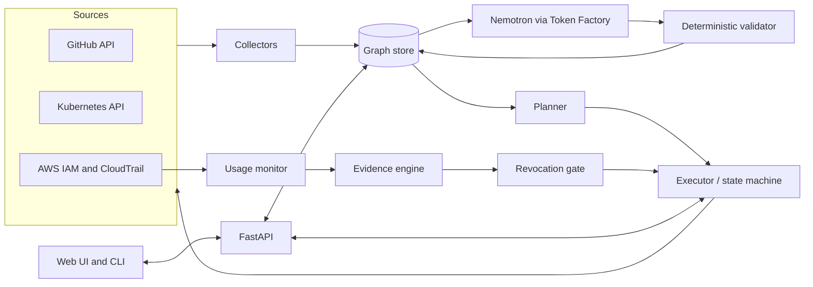

# SafeRotate

> **Revoke with evidence, not hope.**

SafeRotate safely replaces compromised or aging credentials across every place that uses them. It discovers where a credential is used, creates a replacement, updates the known consumers, watches runtime usage of the old credential, and only recommends (and performs) revocation when the evidence says it is safe.

**Hackathon scope:** AWS IAM access keys + GitHub Actions secrets + Kubernetes Secrets, with NVIDIA Nemotron (via Nebius Token Factory) finding semantic relationships between credentials and their consumers.

Built for the [Nebius x NVIDIA Global AI Hackathon](https://nebiusglobalaihackathon.devpost.com/) · Track: **Best Apps and Agents** (alternate: Coding and Agentic Engineering) · License: Apache-2.0

---

## Table of contents

1. [The problem](#1-the-problem)
2. [The idea](#2-the-idea)
3. [What SafeRotate is not (honest limits)](#3-what-saferotate-is-not-honest-limits)
4. [Scope](#4-scope)
5. [Architecture](#5-architecture)
6. [Data model](#6-data-model)
7. [Rotation state machine](#7-rotation-state-machine)
8. [Implementation guide](#8-implementation-guide)
9. [Nemotron and Token Factory usage](#9-nemotron-and-token-factory-usage)
10. [Security model of SafeRotate itself](#10-security-model-of-saferotate-itself)
11. [Repository layout](#11-repository-layout)
12. [Getting started](#12-getting-started)
13. [Demo script (under 3 minutes)](#13-demo-script-under-3-minutes)
14. [Testing and evaluation](#14-testing-and-evaluation)
15. [Hackathon compliance and timeline](#15-hackathon-compliance-and-timeline)
16. [Risks](#16-risks)
17. [Competitive landscape](#17-competitive-landscape)
18. [Roadmap](#18-roadmap)
19. [FAQ](#19-faq)
20. [References](#20-references)

---

## 1. The problem

Secret scanners are good at saying *"AWS key `AKIA…` was committed to GitHub."* The hard operational question comes next:

> **Can I revoke this key without taking production down?**

A single credential is often copied into several places:

```
AWS_PROD_KEY
├── GitHub Actions secret   → deploy workflow
├── Kubernetes Secret       → payments-service
├── Terraform / scripts     → monitoring integration
└── a forgotten cron job    → nobody remembers it
```

Nobody knows what depends on the key, so teams hesitate, and leaked keys stay valid.

**Evidence the gap is real**

- GitGuardian's *State of Secrets Sprawl 2026* retested secrets confirmed valid in 2022 and found about **64% were still exploitable in January 2026**, and it names remediation, not detection, as the bottleneck.
- Supply-chain incidents force mass rotation: the 2025 reviewdog / `tj-actions` compromise exposed CI secrets across more than 23,000 repositories (per CISA), and 2026 npm supply-chain attacks harvested GitHub Actions, AWS, Kubernetes and Vault credentials.
- AWS's own guidance describes rotation as a multi-step manual procedure (create a second key, check last-used, deactivate, wait, delete) and advises against deleting immediately.
- Compliance regimes recommend rotating access keys every 90 days or less, so the need recurs even without incidents.

Sources are listed in [References](#20-references).

---

## 2. The idea

SafeRotate automates the manual procedure and adds the missing ingredient: **runtime evidence.**

```
1. DISCOVER   where the credential is used (GitHub Actions, Kubernetes, AWS logs, scripts)
2. CREATE     a replacement credential
3. UPDATE     all known consumers to use it, then VERIFY each one
4. MONITOR    runtime usage of the old credential (last-used + CloudTrail)
5. REVOKE     only when remaining usage is explained and the soak window has passed
              (deactivate first, delete later)
```

### Two modes

| | **Hygiene mode** (old key, not known leaked) | **Leak mode** (credential compromised) |
|---|---|---|
| Goal | Zero-downtime replacement | Contain fast, then repair |
| Old key during rollout | Stays active | **Deactivated immediately** (reversible) |
| Waiting for "zero usage" | Yes, over a soak window | **No.** Attacker traffic would also count as usage |
| Old-key traffic after cutover | Must be explained by known consumers | Classified as expected vs unknown source |
| Reactivating the old key | Allowed | Dangerous; requires explicit confirmation and a short TTL |

### Evidence-gated revocation

SafeRotate does **not** claim to *prove* safety. It computes a **revocation readiness** verdict (`BLOCKED`, `CAUTION`, `READY`) with listed reasons, and revokes through a reversible step first. See [section 8.4](#84-evidence-engine-and-revocation-gate).

---

## 3. What SafeRotate is not (honest limits)

| Limit | Why | Mitigation in the product |
|---|---|---|
| Cannot find every consumer | Laptops, third-party SaaS, other teams' scripts are invisible to config scanning | Runtime evidence: unknown callers of the old key are surfaced from CloudTrail |
| "Zero usage" is not proof | AWS last-used data does not cover every call; CloudTrail event history is limited to 90 days of management events; S3 object-level calls need data events enabled; quarterly or yearly jobs exist | Coverage-gap warnings, soak window derived from usage history, deactivate-before-delete |
| Cannot read GitHub secret values | GitHub Actions secrets are write-only | Verify by running a workflow that calls `sts get-caller-identity` and checking CloudTrail for the new key ID |
| GitOps can overwrite changes | Argo CD / Flux / External Secrets reconcile Kubernetes Secrets from Git or a vault | Detected and reported as out of scope for the MVP |
| Static keys are the legacy problem | Best practice is to avoid long-lived keys (OIDC, workload identity) | Roadmap: "rotate or eliminate" suggestions |

---

## 4. Scope

### Hackathon MVP (one vertical slice)

- **Credential type:** AWS IAM user access keys
- **Consumers:** one GitHub repository's Actions secret, one Kubernetes Secret (local `kind` cluster)
- **Evidence:** `GetAccessKeyLastUsed` + CloudTrail `LookupEvents`
- **AI:** Nemotron for semantic matching, plan drafting, anomaly triage and explanations, with a deterministic validator checking every model output
- **Interface:** web UI with graph, simulation, plan approval, and live rotation status; CLI for the same actions
- **Safety:** dry-run by default, human approval gates, audit log

### Explicitly out of scope for the MVP

Terraform state, GitOps drift handling, multi-cloud, other secret types, org-wide GitHub scanning, vault integrations.

---

## 5. Architecture



### Components

| Component | Responsibility | Suggested tech |
|---|---|---|
| **Collectors** | Read workflows, Kubernetes specs, IAM metadata, CloudTrail events | Python, `httpx`/PyGithub, `kubernetes`, `boto3` |
| **Graph store** | Nodes and edges with evidence class and citations | SQLite (SQLModel) + NetworkX for traversal |
| **Semantic layer** | Extract and match credential references across messy files | Nemotron through Nebius Token Factory |
| **Validator** | Rejects model output that cites nonexistent lines or violates plan invariants | Plain Python, unit-tested |
| **Planner** | Builds an ordered rotation plan from the graph | Nemotron proposes, validator enforces |
| **Executor** | Runs plan steps idempotently with a state machine and audit log | Python |
| **Usage monitor** | Polls last-used data and CloudTrail for the old key | `boto3` |
| **Evidence engine** | Classifies old-key traffic, computes readiness verdict | Python |
| **API** | Exposes scan, plan, approve, run, status | FastAPI |
| **UI** | Graph view, "revoke now" simulation, plan and run timeline | React + Vite + Cytoscape.js (or React Flow) |
| **Simulator** | Replays recorded CloudTrail and mocked GitHub/Kubernetes for the hosted demo | Fixtures + mock adapters |

---

## 6. Data model

### Node types

`Credential` · `Consumer` (GitHub secret, K8s Secret) · `Pipeline` (workflow) · `Workload` (Deployment, CronJob) · `Principal` (IAM user) · `Observation` (runtime event) · `Plan` · `Step` · `Run`

### Edge: `Credential → Consumer`

| Field | Meaning |
|---|---|
| `evidence_class` | `DECLARED` (static config says so), `INFERRED` (model-proposed, validated), `OBSERVED` (seen in runtime logs), `VERIFIED` (post-update verification passed), `UNKNOWN_CALLER` (runtime caller not mapped to any consumer) |
| `confidence` | 0 to 1, only meaningful for `INFERRED` |
| `citations` | List of `{file, line, snippet_hash}` or log event IDs |
| `first_seen` / `last_seen` | Timestamps |

### Credential fingerprint

Never store secret values. Store the **access key ID** (an identifier, not a secret) and a salted hash of any other material, and refer to credentials by a stable alias (`CRED_1`) in prompts and logs.

---

## 7. Rotation state machine

### Hygiene mode

```
DISCOVERED → PLANNED → APPROVED → NEW_KEY_CREATED → CONSUMERS_UPDATING
   → CONSUMERS_VERIFIED → SOAKING → READY_TO_DEACTIVATE → DEACTIVATED
   → READY_TO_DELETE → DELETED
        │                  │
        └──── BLOCKED ◄────┘  (unexplained caller, update failure, coverage gap)
```

### Leak mode

```
DISCOVERED → CONTAINED (old key deactivated, evidence snapshot exported)
   → PLANNED → APPROVED → NEW_KEY_CREATED → CONSUMERS_UPDATING
   → CONSUMERS_VERIFIED → REVIEW_WINDOW → DELETED
```

### Invariants (enforced by the validator, not the model)

1. Never `DEACTIVATE` in hygiene mode before every known consumer is `VERIFIED`.
2. Never `DELETE` before `DEACTIVATE` plus the required wait.
3. Never create a third key: if the IAM user already has two, require the operator to choose which to retire.
4. No step runs without an approval record, except in dry-run.
5. Reactivating a key marked compromised requires explicit confirmation and a time limit.

### Rollback philosophy

In hygiene mode the **dual-key window is the rollback**: the old key stays valid until the gate passes, so a failed update is fixed forward without an outage. SafeRotate does not store old secret values (GitHub secrets are unreadable anyway).

---

## 8. Implementation guide

### 8.1 Discovery

**GitHub (static)**
- List repo/org/environment secret **names** (values are not readable).
- Read `.github/workflows/*.yml` and find `secrets.NAME` references, the actions they feed (for example `aws-actions/configure-aws-credentials`), and environment names.

**Kubernetes (static)**
- Enumerate Secrets and the Pods/Deployments/CronJobs that reference them via `env.valueFrom.secretKeyRef`, `envFrom.secretRef`, and `volumes[].secret`.
- For each Secret, read `AWS_ACCESS_KEY_ID` locally and compare to the target key ID. Never send the value anywhere.

**AWS (runtime)**
- `iam.list_access_keys`, `iam.get_access_key_last_used`, optional credential report.
- `cloudtrail.lookup_events` filtered by `AccessKeyId` for the last 90 days: record `eventSource`, `eventName`, `awsRegion`, `sourceIPAddress`, `userAgent`, `eventTime`.

**Semantic matching (Nemotron)**
Static parsing covers explicit references. The model handles messy cases: shell scripts, runbooks, READMEs, and inconsistent names (`AWS_SECRET`, `prodAwsCredential`, `DEPLOY_KEY`, `payments_access`). See [section 9](#9-nemotron-and-token-factory-usage).

### 8.2 Creating the replacement key

```python
import boto3

iam = boto3.client("iam")

def create_replacement(user_name: str) -> dict:
    keys = iam.list_access_keys(UserName=user_name)["AccessKeyMetadata"]
    if len(keys) >= 2:
        raise OperatorChoiceRequired("IAM user already has two keys; choose one to retire first")
    new = iam.create_access_key(UserName=user_name)["AccessKey"]
    # new["SecretAccessKey"] is shown only once: keep it in memory, never log or persist it
    return new
```

Before distributing, sanity-check the new key (a separate session calling `sts.get_caller_identity()`); it belongs to the same IAM user, so permissions match.

### 8.3 Updating consumers

**GitHub Actions secret** (values are encrypted with the repo's public key using a libsodium sealed box):

```python
import base64, httpx
from nacl import encoding, public

def encrypt(public_key_b64: str, value: str) -> str:
    pk = public.PublicKey(public_key_b64.encode(), encoding.Base64Encoder())
    return base64.b64encode(public.SealedBox(pk).encrypt(value.encode())).decode()

def update_repo_secret(owner, repo, name, value, token):
    h = {"Authorization": f"Bearer {token}", "Accept": "application/vnd.github+json"}
    base = f"https://api.github.com/repos/{owner}/{repo}/actions/secrets"
    key = httpx.get(f"{base}/public-key", headers=h).json()          # {key_id, key}
    body = {"encrypted_value": encrypt(key["key"], value), "key_id": key["key_id"]}
    httpx.put(f"{base}/{name}", headers=h, json=body).raise_for_status()
```

Environment-level and org-level secrets use different endpoints; the MVP handles repo-level secrets only.

**Verification workflow** (committed to the test repo; triggered with `workflow_dispatch`):

```yaml
name: saferotate-verify
on: workflow_dispatch
jobs:
  verify:
    runs-on: ubuntu-latest
    steps:
      - uses: aws-actions/configure-aws-credentials@<pin-to-commit-sha>
        with:
          aws-access-key-id: ${{ secrets.AWS_ACCESS_KEY_ID }}
          aws-secret-access-key: ${{ secrets.AWS_SECRET_ACCESS_KEY }}
          aws-region: us-east-1
      - run: aws sts get-caller-identity
```

After the run, query CloudTrail for the **new** key ID. Seeing it proves the update landed. Pin third-party actions to commit SHAs.

**Kubernetes Secret + restart**

```python
import base64
from datetime import datetime, timezone
from kubernetes import client, config

config.load_kube_config()
v1, apps = client.CoreV1Api(), client.AppsV1Api()
b64 = lambda s: base64.b64encode(s.encode()).decode()

def update_k8s(ns, secret_name, new_id, new_secret, deployments):
    v1.patch_namespaced_secret(secret_name, ns, {"data": {
        "AWS_ACCESS_KEY_ID": b64(new_id),
        "AWS_SECRET_ACCESS_KEY": b64(new_secret),
    }})
    for d in deployments:  # env-var consumers only pick up changes after a restart
        apps.patch_namespaced_deployment(d, ns, {"spec": {"template": {"metadata": {"annotations": {
            "kubectl.kubernetes.io/restartedAt": datetime.now(timezone.utc).isoformat()}}}}})
    # then wait for rollout and run a verification (e.g. exec a caller-identity check)
```

Detect and report: Secrets managed by GitOps (labels/annotations from Argo CD, Flux, External Secrets) will be overwritten.

### 8.4 Evidence engine and revocation gate

**Inputs:** old-key CloudTrail events, `GetAccessKeyLastUsed`, consumer verification results, trail configuration.

**Step 1: baseline cadence.** From up to 90 days of history for the old key, compute the largest gap between uses.

```
soak_window = clamp(1.5 * max_gap, min = 24h, max = configured_cap)
```

If history is shorter than 90 days or the key predates it, flag `CADENCE_UNKNOWN` (yearly jobs possible) and require an operator override with a written justification.

**Step 2: coverage gaps.** Call `cloudtrail.describe_trails` / `get_event_selectors`. If object-level data events are not enabled, flag `DATA_PLANE_BLIND` because S3 object reads may not appear.

**Step 3: classify old-key traffic after cutover.** Group events by `(sourceIPAddress, userAgent, eventSource, awsRegion)` and compare with expected profiles:

| Consumer | Expected profile |
|---|---|
| Kubernetes workload | Cluster egress/NAT IP (operator-provided) and SDK user agent |
| GitHub Actions | Runner user-agent pattern and **time correlation with workflow runs** (hosted-runner IPs vary) |

Anything not matching becomes `UNKNOWN_CALLER`, shown with first and last seen, the service called, and the region.

**Step 4: verdict.**

| Verdict | Condition |
|---|---|
| `BLOCKED` | Any known consumer not `VERIFIED`, any `UNKNOWN_CALLER` inside the window, or key already at the two-key limit |
| `CAUTION` | Soak window not elapsed, `CADENCE_UNKNOWN`, or `DATA_PLANE_BLIND` |
| `READY` | All consumers verified, window elapsed, no unexplained callers, coverage gaps acknowledged |

Revocation sequence: **deactivate**, wait a configurable observation period (for example 24 to 48 hours), then **delete**. Failures after deactivation are detected through signals outside CloudTrail (CI job failures, pod error rates). Verify what CloudTrail records for rejected requests before relying on it for break detection.

### 8.5 Leak mode specifics

1. Export an evidence snapshot (90 days of CloudTrail for the old key) for forensics.
2. Deactivate the old key immediately (reversible).
3. Create the replacement and update consumers as in hygiene mode, with higher urgency.
4. Show "what likely breaks" from the dependency graph.
5. Treat any further old-key attempts as suspicious; surface them in the UI.
6. Reactivation is a security decision: confirmation plus a short TTL.

### 8.6 API and CLI

```
POST /scan                      start discovery
GET  /graph                     nodes, edges, evidence classes
POST /plans                     {credential, mode} -> draft plan (validated)
POST /plans/{id}/approve        record approval
POST /runs                      execute an approved plan (supports dry_run)
GET  /runs/{id}                 state, steps, audit log
GET  /evidence/{credential}     readiness verdict with reasons
POST /runs/{id}/deactivate      guarded by the gate
POST /runs/{id}/delete          guarded by the gate and observation period
```

```
saferotate scan
saferotate plan  --key AKIA... --mode hygiene|leak
saferotate run   --plan <id> --dry-run
saferotate status --run <id>
saferotate revoke --run <id> --confirm
```

### 8.7 Simulator mode (for judges)

Judges cannot be given real cloud access. `SAFEROTATE_MODE=simulator` replays recorded CloudTrail events and mocked GitHub/Kubernetes responses from `fixtures/`, while **Nemotron calls remain live** through Token Factory. The hosted demo must say plainly that it is a simulation. The video shows a real run against a sandbox AWS account.

---

## 9. Nemotron and Token Factory usage

The principle: **the model proposes, the validator disposes.** Model output never executes directly.

| Task | Model tier | Input | Output |
|---|---|---|---|
| **T1 File triage** | Nano or Super (fast, bulk) | File chunks | JSON list of credential-like references with line numbers |
| **T2 Entity resolution** | Ultra (reasoning) | Symbols and context across files | Groups of references that denote the same credential, with rationale and citations |
| **T3 Plan synthesis** | Ultra | Graph and mode | Ordered steps from a fixed action vocabulary |
| **T4 Anomaly triage** | Super | Unexplained CloudTrail callers | Advisory label: likely forgotten consumer vs suspicious |
| **T5 Report and explanation** | Super | Graph, verdict, run log | Plain-language blast-radius and incident summary |

Model names and endpoint come from environment variables. Confirm exact model IDs and the API base URL in your Token Factory console.

### Constrained plan vocabulary

`CREATE_KEY` · `UPDATE_GH_SECRET` · `PATCH_K8S_SECRET` · `RESTART_WORKLOAD` · `VERIFY_CONSUMER` · `SOAK` · `DEACTIVATE_KEY` · `DELETE_KEY`

### Validator checks

- Every citation points to a file and line that exists, and the snippet appears there.
- Every plan step uses an allowed action and satisfies the [invariants](#invariants-enforced-by-the-validator-not-the-model).
- Entity-resolution groups never merge credentials with different key IDs unless static evidence agrees.
- Low-confidence matches are labeled `INFERRED` and require human confirmation before they become update targets.

### Data hygiene

- Replace key IDs with aliases (`CRED_1`) and never send secret values to any model or external API.
- Run a high-entropy string filter on all prompt text.
- Log prompt and response hashes, not content.

### Example T2 response schema

```json
{
  "groups": [
    {
      "credential_alias": "CRED_1",
      "members": [
        {"symbol": "AWS_SECRET", "file": ".github/workflows/deploy.yml", "line": 18},
        {"symbol": "prodAwsCredential", "file": "scripts/backup.sh", "line": 4}
      ],
      "rationale": "Both feed the same S3 sync step used by the deploy job",
      "confidence": 0.82
    }
  ]
}
```

### Optional: Tavily (bonus prize)

Look up current rotation behavior per provider (for example, whether a service supports two active keys) using generic queries only, never including identifiers or secrets. Show the findings as notes inside the plan.

---

## 10. Security model of SafeRotate itself

SafeRotate holds powerful permissions, so it must be built like a security product.

### Principles

- Dry-run by default; every mutating step needs approval.
- Secret values live only in memory during a run; never logged, persisted, or placed in prompts.
- Least-privilege credentials for every integration, scoped to managed resources.
- Append-only audit log of every action and decision.
- The hosted demo never accepts real credentials or private repositories.

### Example IAM policy for SafeRotate (scope to a managed path)

```json
{
  "Version": "2012-10-17",
  "Statement": [
    {
      "Sid": "ManageKeysOnManagedUsersOnly",
      "Effect": "Allow",
      "Action": [
        "iam:ListAccessKeys", "iam:CreateAccessKey", "iam:UpdateAccessKey",
        "iam:DeleteAccessKey", "iam:GetAccessKeyLastUsed", "iam:GetUser"
      ],
      "Resource": "arn:aws:iam::<ACCOUNT_ID>:user/saferotate-managed/*"
    },
    {
      "Sid": "ReadUsageEvidence",
      "Effect": "Allow",
      "Action": [
        "cloudtrail:LookupEvents", "cloudtrail:DescribeTrails", "cloudtrail:GetEventSelectors"
      ],
      "Resource": "*"
    }
  ]
}
```

### Kubernetes RBAC (namespaced)

```yaml
apiVersion: rbac.authorization.k8s.io/v1
kind: Role
metadata: {name: saferotate, namespace: payments}
rules:
  - apiGroups: [""]
    resources: ["secrets"]
    verbs: ["get", "list", "patch"]
  - apiGroups: ["apps", "batch"]
    resources: ["deployments", "cronjobs", "statefulsets"]
    verbs: ["get", "list", "patch"]
  - apiGroups: [""]
    resources: ["pods"]
    verbs: ["get", "list"]
```

### GitHub token

Use a fine-grained token limited to the target repository with permissions for Secrets (read/write), Actions (write, to dispatch the verification workflow), Contents (read), and Metadata (read).

### Threat model (summary)

| Threat | Mitigation |
|---|---|
| SafeRotate compromised | Scoped credentials, approval gates, audit log, no stored secret values |
| Prompt injection via repo files | Model output is validated; model cannot execute actions; untrusted file text is treated as data |
| Model hallucinates a consumer | Citations verified; `INFERRED` edges need human confirmation |
| Secrets leak through prompts or logs | Aliasing, entropy filter, hash-only logging |
| Wrong key deleted | Two-key checks, deactivate-first, observation period |

---

## 11. Repository layout

```
saferotate/
├── README.md
├── LICENSE                      # Apache-2.0 (must be visible in the repo's About section)
├── pyproject.toml
├── Makefile
├── backend/
│   ├── api/                     # FastAPI routes
│   ├── collectors/              # github.py, kubernetes.py, aws.py
│   ├── graph/                   # models, store, queries
│   ├── ai/                      # token_factory client, prompts, schemas, validator
│   ├── planner/                 # plan synthesis + invariants
│   ├── executor/                # state machine, steps, audit log
│   ├── evidence/                # cadence, coverage, caller classification, verdict
│   └── simulator/               # replay adapters
├── cli/                         # saferotate CLI
├── frontend/                    # React + Vite + Cytoscape.js
├── sandbox/                     # scripts to build the demo environment
│   ├── aws_setup.sh
│   ├── kind-cluster.yaml
│   ├── payments-deployment.yaml
│   └── shadow-cron.sh
├── fixtures/                    # recorded CloudTrail + mocked API responses
├── eval/                        # labeled dataset + scoring scripts
└── tests/
```

---

## 12. Getting started

### Prerequisites

- Python 3.11+, Node 20+
- Docker, `kind`, `kubectl`
- AWS CLI and a **sandbox** AWS account (never a production account)
- A throwaway GitHub repository and fine-grained token
- A Nebius account (the Builder Program provides Token Factory credits)

### Configuration

```bash
cp .env.example .env
```

```
NEBIUS_API_KEY=...
NEBIUS_API_BASE=...                # confirm in your Token Factory console
NEMOTRON_ULTRA_MODEL=...           # model IDs from the Token Factory catalog
NEMOTRON_SUPER_MODEL=...
NEMOTRON_NANO_MODEL=...
AWS_PROFILE=saferotate-admin
GITHUB_TOKEN=...
GITHUB_REPO=owner/repo
KUBE_CONTEXT=kind-saferotate
SAFEROTATE_MODE=live               # or simulator
TAVILY_API_KEY=                    # optional
```

### Build the demo sandbox

```bash
# 1. IAM user whose key we will rotate (managed path, read-only S3)
aws iam create-user --user-name saferotate-demo-app --path /saferotate-managed/
aws iam attach-user-policy --user-name saferotate-demo-app \
  --policy-arn arn:aws:iam::aws:policy/AmazonS3ReadOnlyAccess
aws s3 mb s3://saferotate-demo-<random-suffix>
aws iam create-access-key --user-name saferotate-demo-app   # keep output private

# 2. Kubernetes consumer
kind create cluster --name saferotate --config sandbox/kind-cluster.yaml
kubectl create namespace payments
kubectl -n payments create secret generic aws-creds \
  --from-literal=AWS_ACCESS_KEY_ID=<id> --from-literal=AWS_SECRET_ACCESS_KEY=<secret>
kubectl apply -f sandbox/payments-deployment.yaml   # loops: aws s3 ls every minute

# 3. GitHub consumer: add repo secrets AWS_ACCESS_KEY_ID / AWS_SECRET_ACCESS_KEY,
#    commit deploy.yml and saferotate-verify.yml to the test repo

# 4. Hidden consumer: run sandbox/shadow-cron.sh on a laptop or small VM using the OLD key
#    (this is the "forgotten script" SafeRotate must catch)
```

### Run

```bash
make install
make dev            # backend on :8000, frontend on :5173

saferotate scan
saferotate plan --key <OLD_KEY_ID> --mode hygiene
saferotate run  --plan <id> --dry-run
```

---

## 13. Demo script (under 3 minutes)

The judges are not required to watch past three minutes, so lead with the strongest moment.

| Time | Scene |
|---|---|
| 0:00 to 0:20 | Problem and statistic: leaked keys stay valid because nobody knows what breaks |
| 0:20 to 1:00 | Scan: graph appears (GitHub workflow, Kubernetes payments service, AWS key). Nemotron links differently named references; each edge shows its evidence class |
| 1:00 to 1:25 | "If revoked now" simulation: payments and deploy break |
| 1:25 to 2:15 | Rotation: create key, update GitHub secret and Kubernetes Secret, restart, verification workflow, new key appears in CloudTrail |
| 2:15 to 2:45 | The twist: the old key is **still used by an unknown caller** (the forgotten cron). SafeRotate blocks revocation and shows the caller's IP, user agent, and service |
| 2:45 to 3:00 | Resolve the caller, verdict becomes READY, deactivate; show Nemotron and Token Factory usage and eval numbers |

CloudTrail delivery takes minutes; edit the waiting segments out of the video and say so in the description.

---

## 14. Testing and evaluation

### Automated tests

| Layer | Approach |
|---|---|
| Parsers (workflows, manifests) | Unit tests with fixture files |
| AWS logic | `moto` for IAM; fixtures for CloudTrail events |
| GitHub client | HTTP mocking (`respx`) |
| Kubernetes | Integration tests on `kind` |
| Validator and invariants | Property-style tests: every rejected plan violates an invariant |
| State machine | Transition tests including failure paths |
| End to end | Sandbox script run before every release candidate |

### Nemotron evaluation

Create a labeled set of 40 to 60 snippets (synthetic plus public repositories) with known credential groupings, including tricky naming.

| Metric | Why |
|---|---|
| Grouping precision and recall | Core semantic task |
| Baseline comparison | Regex plus string similarity, to show what the model adds |
| Citation validity rate | Share of citations that pass the validator |
| Plan validity rate | Share of plans passing invariants on first try |

Report results in this table (fill with measured numbers only):

| Method | Precision | Recall | Citation validity |
|---|---|---|---|
| Regex + similarity baseline | TBD | TBD | n/a |
| Nemotron (Nano/Super triage) | TBD | TBD | TBD |
| Nemotron (Ultra resolution) | TBD | TBD | TBD |

---

## 15. Hackathon compliance and timeline

Rules checked against the official page on October 11, 2026. Rules can change, so re-read before submitting: https://nebiusglobalaihackathon.devpost.com/rules

### Requirements checklist

- [ ] Working app that makes a **runtime call to Nebius Token Factory** (or runs on Nebius AI Cloud)
- [ ] Uses at least one **NVIDIA open-source model** (Nemotron)
- [ ] One track selected (Best Apps and Agents, or Coding and Agentic Engineering)
- [ ] **Public repository** with a detectable open-source license (Apache-2.0, MIT, or MPL-2.0)
- [ ] README with setup instructions that highlights Nemotron use and where Token Factory helped (section 9)
- [ ] Hosted demo URL, free for judges, **available until the judging period ends (December 15)**
- [ ] Text description of features
- [ ] Demo video **under 3 minutes**, public on YouTube, shows the project running, no copyrighted music
- [ ] Feedback on Nebius Token Factory / AI Cloud and NVIDIA tools (also eligible for Most Valuable Feedback)
- [ ] English materials
- [ ] If the project predates the submission period, explain what was significantly updated

### Judging criteria (equally weighted) and how we address them

| Criterion | Our answer |
|---|---|
| Technological Implementation | Tiered Nemotron use (Nano/Super/Ultra), validator-checked outputs, measured evaluation, state machine with invariants |
| Design | Complete workflow: graph, simulation, plan, approval, live run, verdict, audit trail |
| Potential Impact | Documented problem, concrete audience (platform/DevSecOps teams on AWS + GitHub Actions + Kubernetes), demonstration on a realistic sandbox |
| Quality of the Idea | Evidence-gated revocation and unknown-caller detection rather than a static dependency map |

### Optional bonus targets

- **Best Use of Tavily:** requires a functional runtime call to the Tavily API.
- **City Winner Awards:** require attending a participating in-person Builders & Brews event.
- **Most Valuable Feedback:** complete the feedback section thoughtfully.

### Timeline (deadline: Friday, October 30, 2026, 10:00 am Pacific)

| Dates | Milestone |
|---|---|
| Oct 11 to 12 | Join the Nebius Builder Program, confirm Token Factory access and model IDs, create the sandbox, choose a test repo |
| Oct 13 to 18 | Collectors (GitHub, Kubernetes, AWS), graph store, basic UI |
| Oct 19 to 22 | Nemotron pipeline (T1 to T2), validator, labeled dataset and evaluation |
| Oct 23 to 26 | Planner, executor, monitor, evidence engine, leak mode |
| Oct 27 to 28 | Simulator, hosted demo, UI polish, tests, README results |
| **Oct 29** | Record video, upload, final README, **submit** (do not wait for the morning of the 30th) |
| Dec 1 to 15 | Judging: keep the demo running |

### Suggested team roles (adjust to team size)

AWS and evidence engine · GitHub and Kubernetes integrations · AI pipeline, validator and evaluation · Frontend, simulator and demo video.

---

## 16. Risks

| Risk | Impact | Mitigation |
|---|---|---|
| Scope creep | Unfinished demo | Strict vertical slice; cut list in section 4 |
| Model seems incidental | Lower technology and idea scores; Stage One pass/fail risk | Give the model real work (T1 to T5), show evaluation numbers |
| CloudTrail delay makes the live demo slow | Awkward video | Edit waits; use `GetAccessKeyLastUsed` as the faster signal where possible |
| Hosted demo needs real cloud access | Security exposure and untestable by judges | Simulator mode with live Nemotron calls |
| Tool holds powerful credentials | Security liability | Section 10 controls; sandbox account only |
| Credits expire before judging ends | Demo goes down | Check credit validity; plan hosting through December 15 |
| Overclaiming "proof" | Credibility loss | Use "evidence-gated" language everywhere |

---

## 17. Competitive landscape

| Approach | What it does | How SafeRotate differs |
|---|---|---|
| **Secrets platforms** (Doppler, Akeyless, Vault) | Central store and rotation; Doppler can rotate AWS keys and write them to GitHub Actions | Requires consumers to adopt the platform; SafeRotate works on existing scattered static keys |
| **AWS Secrets Manager** | Managed rotation for stored secrets | Limited to secrets it manages |
| **NHI / secrets-security vendors** (GitGuardian, Astrix, Entro, Oasis) | Discovery, context, rotation guidance, some automation via vault partners | Commercial platforms; SafeRotate is open source, local-first, and centered on runtime-evidence gating |
| **Eliminate static keys** (GitHub OIDC, IRSA / workload identity) | Removes the need to rotate | The long-term answer, but legacy keys remain; SafeRotate's roadmap suggests migration |

The wedge: **existing static AWS keys, no migration to a vault, revocation gated by runtime evidence.** Absence of an identical product in our research is not proof none exists.

---

## 18. Roadmap

1. GitOps awareness (Argo CD, Flux, External Secrets): update the source of truth, not the cluster
2. More credential types (GitHub PATs, Stripe, database passwords) behind a provider plugin interface
3. Terraform and cloud-config discovery
4. Org-wide GitHub coverage (environment and org secrets)
5. "Rotate or eliminate": propose OIDC and workload-identity migrations per consumer
6. Slack/Teams approvals and incident-ticket integration
7. GCP and Azure credential types
8. Continuous mode: scheduled 90-day rotation with the same evidence gate

---

## 19. FAQ

**Why not just use AWS Secrets Manager?**
It rotates secrets it manages. Most incidents involve keys already copied into many places.

**Isn't "usage reached zero" enough?**
No, which is why SafeRotate uses a soak window, coverage-gap warnings, unknown-caller detection, and reversible deactivation before deletion.

**What if the key is already leaked?**
Use leak mode: contain first, repair second. Waiting for zero usage doesn't work when an attacker is calling the key.

**Does the model ever see my secrets?**
No. Secret values are never sent to models or external APIs; identifiers are aliased.

**Can the model run commands?**
No. It proposes structured output that a deterministic validator checks; only the executor performs actions, with approval.

---

## 20. References

- GitGuardian, *State of Secrets Sprawl 2026*: https://www.gitguardian.com/state-of-secrets-sprawl-report-2026
- AWS IAM, *Updating access keys*: https://docs.aws.amazon.com/IAM/latest/UserGuide/Using_RotateAccessKey.html
- AWS re:Post, *Manage IAM access keys securely*: https://repost.aws/knowledge-center/manage-iam-access-keys-securely
- InfoWorld, cascading GitHub Actions supply-chain attack (reviewdog / tj-actions): https://www.infoworld.com/article/3849245/github-suffers-a-cascading-supply-chain-attack-compromising-ci-cd-secrets.html
- Cloud Security Alliance research note on the June 2026 npm supply-chain attack (Miasma): https://labs.cloudsecurityalliance.org/wp-content/uploads/2026/06/CSA_research_note_miasma_npm_supply_chain_redhat_20260603-csa-styled.pdf
- NHI Management Group, *When should organisations rotate credentials after a supply chain incident?*: https://nhimg.org/faq/when-should-organisations-rotate-credentials-after-a-supply-chain-incident/
- Nebius x NVIDIA Global AI Hackathon rules: https://nebiusglobalaihackathon.devpost.com/rules

---

## License

Apache-2.0. See [LICENSE](LICENSE).

## Acknowledgements

Built with NVIDIA Nemotron models on Nebius Token Factory.
