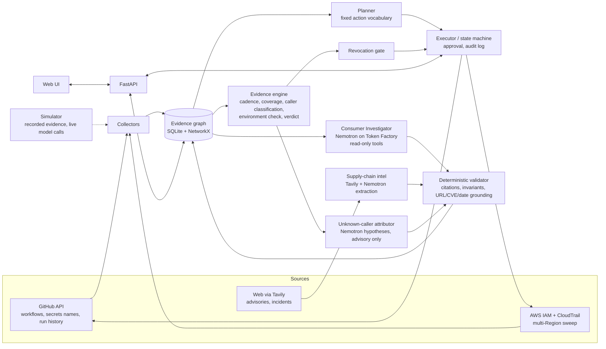

# SafeRotate — Scope, Architecture & Design Refinements

**Status:** v1 — written Oct 11, 2026, **before** spike results. Sections marked **[SPIKE-DEPENDENT]** will be revised once `spike/RESULTS.md` comes back.
**Companion docs:** `01_spike_test_README.md` (what we measure), `03_competitive_research.md` (what the industry does, with sources).
**Deadline:** Fri Oct 30, 2026, 10:00 a.m. Phoenix (MST). Plan to submit Thu Oct 29.

**Team size / skills: still unknown.** Everything below is tiered (P0/P1/P2) so it can be sliced to the team you have.

---

## 0. TL;DR

1. The core idea still holds, but the competitive research changed the pitch. **At least one NHI vendor (Oasis) publicly claims to flag old keys that are still in use before shutdown, and GitGuardian already maps consumer applications.** "Evidence-gated revocation" is therefore not a novel *concept*. It is still a strong *product wedge* if we position it as **open-source, local-first, explicit about evidence quality, and honest about coverage gaps.** (Details in doc 03.)
2. The three weakest points are: **(a) Nemotron is incidental** to the headline moments, **(b) Tavily is bolted on**, **(c) scope exceeds the calendar**. Plus a hidden fourth: **(d) several evidence assumptions are unverified** and one of them can break the demo.
3. Best fixes: turn Nemotron into an **evidence-citing "Consumer Investigator" agent** (tool-using, validator-checked) and the **unknown-caller attributor**; turn Tavily into **supply-chain compromise-window correlation** (which secrets were exposed to a compromised action, so which to rotate in leak mode first).
4. A new, cheap, memorable feature fell out of the research: a **"Cloudflare check"** — detect when the new key was deployed to the *wrong environment* (the March 2025 Cloudflare R2 failure mode) by requiring the new key to be seen from the *intended* consumer before the old key is touched.
5. Cut list: CLI, Kubernetes *write* path (keep discovery), separate T4/T5 model tasks, org-wide anything. Keep a **lite** leak mode (3 steps) because the Tavily feature feeds it.

---

## 1. Weak points, ranked

| # | Weak point | Severity | Hits which judging criterion | Why it's weak today |
|---|---|---|---|---|
| W1 | **Model is incidental** | 🔴 High | Technological Implementation, Quality of Idea; Stage-1 viability | Per the README, the gate, state machine, and CloudTrail evidence are all deterministic. Nemotron only matches names. A judge can say "regex + a rules engine does this." |
| W2 | **Tavily is bolted on** | 🟠 Med-High | Best Use of Tavily ($3,000); Idea | "Look up rotation behavior per provider" produces notes that don't change any decision. Bolted-on integrations read as box-ticking. |
| W3 | **Scope vs. 19 days** | 🔴 High | Everything (an unfinished demo scores nothing) | 3 integrations + graph UI + state machine + leak mode + CLI + simulator + 5 model tasks + eval set + hosted demo. |
| W4 | **Evidence assumptions unverified** | 🔴 High | Technological Implementation, Design (demo can fail live) | See §2. Several documented AWS behaviors constrain the design more than the README admits. |
| W5 | **Hosted demo is a simulator** | 🟠 Medium | Potential Impact credibility | Judges see replayed fixtures. Without care it looks staged. |
| W6 | **Eval may be too easy** | 🟠 Medium | Technological Implementation | A synthetic set where regex ties Nemotron proves nothing. |
| W7 | **Some README claims overstated** | 🟠 Medium | Credibility | E.g., the "23,000 repositories exposed" figure (see §6). |
| W8 | **"Prove nothing, claim nothing" positioning not yet battle-tested vs. Oasis/GitGuardian** | 🟠 Medium | Quality of the Idea | Differentiation must be stated precisely, not as "nobody does this." |
| W9 | **Portfolio goal ("production-grade") under-specified** | 🟡 Low-Med | Design | No quality bar defined (tests, CI, Docker, docs, threat model). |

---

## 2. Technical assumptions that constrain the design [SPIKE-DEPENDENT]

Verified from AWS documentation during research (to be re-verified empirically by the spike):

| Fact | Source | Design consequence |
|---|---|---|
| `LookupEvents` returns **management events** (and Insights), last **90 days**, **per Region**, **50 results/page**, ~**2 requests/sec/account/Region**; `AccessKeyId` is a supported lookup attribute | AWS CloudTrail docs | A hidden caller in *another Region* is invisible unless we sweep every enabled Region. A sweep is slow at 2 rps. **Design a multi-Region sweep with backoff and show progress in the UI.** |
| S3 object-level calls are data events (expected absent from `LookupEvents`) | AWS docs (to confirm in spike) | **The demo's consumers must make calls that appear as management events** (e.g., `sts get-caller-identity`, `ListBuckets`), or we need a trail with data events. Our "DATA_PLANE_BLIND" warning is a real feature, not a footnote. |
| `GetAccessKeyLastUsed` returns last-used time, service, and Region; reports "never used" if no tracking data | AWS IAM API reference | Useful as a coarse signal. **Latency is undocumented in what I found: measure it.** |
| IAM Access Analyzer's unused-access analysis flags access keys unused for a configured window (90 days default), re-evaluates every 24 hours, and recommends deactivating or deleting | AWS docs/blog | AWS already offers "unused key" detection. Our value is *active* keys with multiple consumers, not unused ones. Mention in the pitch. |
| An IAM user can hold at most two access keys | AWS docs; Doppler docs | Invariant #3 ("never create a third key") is correct, and some rotators silently delete one key each time (Doppler's doc says to assume it does). **Our explicit operator-choice step is a differentiator.** |
| GitHub Actions secrets are write-only | GitHub docs | Verification-by-run + CloudTrail new-key-ID check is the only way to confirm an update landed. Keep it. |

**Decision rules once spike results arrive**

| Spike finding | Design change |
|---|---|
| Calls visible in `LookupEvents` quickly | Proceed as designed. |
| Only management events visible | Keep design; demo consumers use management-event calls; ship DATA_PLANE_BLIND warning prominently. |
| Delay > ~30 min or flaky | Add an **explicit "evidence freshness" indicator** (time since last event sync); soak windows already hide the delay; edit waits out of the video. |
| Failed calls on deactivated key not in CloudTrail | "Break detection" after deactivation uses consumer-side signals (workflow re-run results, pod readiness), not CloudTrail. Be explicit in docs. |
| Nothing useful by key ID | Switch to CloudTrail trail → S3 → Athena, or CloudTrail Lake. Big re-scope. |

---

## 3. Strengthening the model's role (fixes W1)

**Principle (keep):** *the model proposes, the validator disposes.* Model output never executes directly.

**Principle (add):** *the model should do the part that is genuinely hard and heterogeneous* — reading messy files and reasoning across clues — *while the deterministic engine does the part that must be exact.* Make that split visible in the product and the video.

### 3.1 From "name matcher" to "Consumer Investigator" (P0)
A short, bounded **tool-using loop** (Nemotron Super is described by Nebius as built for tool calling and multi-step planning). Tools are **read-only and whitelisted**:

| Tool | Returns |
|---|---|
| `list_files(glob)` / `read_file(path, range)` | Repo content (secrets never present; key IDs aliased) |
| `grep(pattern)` | Matches with file:line |
| `workflow_runs(workflow, since)` | Run times from the GitHub API |
| `caller_summary(key_alias)` | Aggregated CloudTrail callers (IP, UA, events, cadence) |

Output: a graph of consumers where every edge has `evidence_class` and **citations that the validator re-checks** (file exists, line contains the symbol, event IDs exist). `INFERRED` edges require human confirmation.

*Why this scores:* it's agentic, uses long-context and tool calling (the model's stated strengths), has no regex fallback that could do the same job on messy repos, and it produces the exact moment judges remember — "it found the forgotten script nobody listed."

### 3.2 Unknown-caller attribution (P0)
When the evidence engine finds an `UNKNOWN_CALLER`, Nemotron gets the *deterministic* facts (IP, user agent, services/API calls, Region, call cadence derived from timestamps) plus repo/crontab clues, and returns a **ranked hypothesis list**: "Likely `scripts/backup.sh` (cron, every 15 min; matches `aws-cli` UA and `ListBuckets`/`sts` cadence)" with confidence, supporting citations, and a **"how to confirm" step** (e.g., "check crontab on host X"). The validator checks that cited evidence exists; the *hypothesis* is advisory and never auto-resolves a block.
Entro publicly describes baselining agent behavior and generating natural-language incident descriptions, so this pattern is validated in the market (see doc 03); ours is open-source and evidence-cited.

### 3.3 Reliability machinery (P1) — what makes it "technological implementation"
- **Self-consistency:** run entity resolution 3× and vote. Disagreement → the edge is `INFERRED` and flagged in the UI. Report a calibration plot (confidence vs. correctness).
- **Tiered models as an explicit cost/latency/accuracy trade-off:** Nano for bulk triage, Super for investigation, Ultra only where verifiable gain exists (if available). Publish a small chart: accuracy vs. latency vs. cost per scan. This also showcases Token Factory's model range.
- **Prompt-injection red-team as a feature:** commit a repo file containing malicious instructions; show the validator and action vocabulary neutralize it. A security product that demonstrates its own threat model reads as production-grade.
- **Constrained outputs:** use JSON-schema structured output if Token Factory supports it (marketing says structured JSON and function calling are native; spike verifies).

### 3.4 A harder, more honest evaluation (P0 for credibility)
Replace "40–60 synthetic snippets" with a benchmark designed to *defeat* regex:
- Renamed variables, indirection (SSM/Secrets Manager reads), templated values (Helm, Terraform, compose, Ansible, Makefile), docs/README-only references, decoys (`AWS_REGION`), and near-duplicate users.
- Baselines: **(A)** regex+string similarity; **(B)** an off-the-shelf secret scanner for *detection* (note: scanners such as TruffleHog/Gitleaks find secrets; they don't link consumers, so the comparison is "what do you get without us?").
- Metrics: pair precision/recall, citation validity, consistency across runs, cost per scan.
- **Publish failures.** Showing where Nemotron is wrong (and the validator catching it) beats a perfect-looking table.

### 3.5 Optional Nebius depth (P2)
Judges assess effective use of Token Factory *and AI Cloud*. Deploying one component (e.g., the evaluation harness as a **Serverless Job**, or the API as a **Serverless Endpoint**) adds depth. Caveats: the advertised credits are for Token Factory, not AI Cloud compute; costs are unverified; and rules require only one of the two routes. Treat as stretch.

---

## 4. Strengthening Tavily (fixes W2)

**Test for "load-bearing":** if we removed Tavily, would a decision in the product change? Today: no. Target: yes.

### 4.1 Supply-chain compromise-window correlation (P0 — the main Tavily feature)
Your own README cites the reviewdog/`tj-actions` compromise. Make it a product behavior:

1. **Collector** lists third-party Actions pinned in the workflows that touch the credential (public names only).
2. **Tavily search + extract** (domains such as GitHub advisories, NVD, CISA, vendor blogs) fetches advisories and incident write-ups for each action.
3. **Nemotron** extracts structured findings (status, CVE IDs, **compromise window**, evidence URLs). The **validator requires every URL to be in the Tavily result set and every CVE/date to appear literally in retrieved text.**
4. **Deterministic correlation:** compare the window with the repo's **workflow run history** (GitHub API) to find *which runs executed the compromised action during the window* → *which secrets those runs could read* → **recommend leak mode for exactly those credentials, ranked first.**

**Why it's load-bearing:** the Tavily result changes the recommended mode, the priority order, and the "who's exposed" list. Remove Tavily and the product can't answer "were my secrets exposed to this incident?"

Background (verified): the March 2025 `tj-actions/changed-files` compromise was widely reported as affecting 23,000+ repos that *use* the action; follow-up analyses found far fewer repos actually leaked secrets (one analysis counted 218). **That discrepancy is exactly why run-history correlation is valuable** — "uses the action" ≠ "exposed." Use it in the pitch (with corrected numbers).

### 4.2 Smaller Tavily uses (P1/P2)
- **Advisory notes in the plan:** attach advisory links/summaries to each action in the blast-radius view. Cheap, useful, but not sufficient alone.
- **Provider rotation semantics** (roadmap for more credential types): e.g., does the provider support two active keys? Keep as roadmap, not MVP.
- **Credits & privacy:** free tier is 1,000 credits/month (basic search = 1, advanced = 2; extract is 1–2 credits per 5 URLs). Cache results per action+day. Queries contain only public identifiers.

### 4.3 Risk [SPIKE-DEPENDENT]
If Tavily results don't reliably contain machine-extractable compromise windows, degrade gracefully: use Tavily for "advisory exists + link + CVE," and make window correlation a manual input ("enter the advisory window").

### 4.4 Stacking reminder
Rules: a project gets **one Overall Award, or one Track Award plus one Bonus Award.** So a Track win + Tavily ($3,000) is the best *stack*, whereas placing 1st–3rd is the biggest single prize and replaces track/bonus. Build for the best product; integrate Tavily either way because it's now genuinely useful.

---

## 5. New high-value, low-cost features from the research

| Feature | Source of idea | Cost | Value |
|---|---|---|---|
| **"Cloudflare check"** — require the new key to be observed from the *intended* consumer (e.g., prod workflow/pod), not just *some* consumer, before touching the old key. Detect "deployed to the wrong environment." | Cloudflare's March 21, 2025 post-mortem: new credentials went to a *development* instance; old ones were deleted; production lost auth; effects were gradual because deletion propagation was delayed. Their remediation list includes logging credential IDs and verifying usage before decommissioning. | Low (reuses the verify step + CloudTrail) | Very high narrative value; judges recognize the incident. |
| **Blast-radius context on the key** — what can this key actually do (attached policies) | Triage tools such as geiger score "capability × reach × sensitivity" | Low-Med (`iam:ListAttachedUserPolicies` etc.) | Improves prioritization; optional. |
| **Ownership suggestion** from usage patterns | Oasis describes suggesting owners from usage | Low | Optional |
| **Rotate-or-eliminate nudge** | AWS and the `configure-aws-credentials` action recommend OIDC over long-lived keys | Low (text + detection of `aws-access-key-id` usage) | Credibility; roadmap hook |

---

## 6. Corrections to apply to the README before submission

| README claim | Finding | Fix |
|---|---|---|
| "About 64% still exploitable in January 2026" (GitGuardian) | **Verified.** GitGuardian reports >64% of secrets confirmed valid in 2022 were still valid at the Jan 2026 retest (down from ~70% a year earlier). | Keep; say "validity rate, per GitGuardian's own retest." |
| "reviewdog/tj-actions compromise exposed CI secrets across more than 23,000 repositories (per CISA)" | The 23,000+ figure is the number of repos **using** the action. Later analyses reported far fewer actual secret exposures (218 in one analysis). | Rephrase: "used by 23,000+ repos; actual secret exposure was far smaller, which is why you need run-level evidence." |
| "CloudTrail event history is limited to 90 days of management events" | **Verified** (plus per-Region, paging, throttling constraints — add them). | Add the constraints to §3 limits. |
| "Absence of an identical product in our research is not proof none exists" | Good, **and now more important**: Oasis markets mapping consumers and flagging old keys in use. | Reword the wedge (§7). |
| "Competitive table" | Missing M&A context, the OSS rotators, and native AWS tooling. | Replace with doc 03's matrix. |
| "Miasma" npm note and the CSA PDF | Not verified in this research. | Verify or remove. |

---

## 7. Positioning (replaces the wedge statement)

**Don't say:** "nobody does evidence-gated rotation."
**Say:** "Enterprise NHI platforms discover and govern machine identities, and some map consumers. We bring the *evidence-gated rotation procedure* to teams who can't buy or deploy a platform: **open-source, local-first, explicit about evidence quality (declared / inferred / observed / verified / unknown), cited, and honest about what it can't see.** The model investigates; a deterministic validator and gate decide."

Market context (sources in doc 03): Cisco announced the acquisition of Astrix on May 4, 2026 (closed June 29, reported ~$400M) and SailPoint acquired Entro (announced mid-June, closed June 29, reported ~$200M). Incumbents are absorbing NHI security — it validates the problem, and leaves little for small teams. Frame impact around *teams without a platform*.

---

## 8. Revised scope (tiers)

### P0 — the demo cannot exist without these
1. **AWS evidence engine:** key metadata, last-used, CloudTrail multi-Region sweep, caller classification, readiness verdict (`BLOCKED/CAUTION/READY`) with reasons, coverage warnings.
2. **GitHub Actions consumer:** discover secret names and `secrets.*` references; update secret (sealed box); dispatch verify workflow; confirm new key ID in CloudTrail.
3. **One "hidden consumer"** in the sandbox (cron on a VM/laptop) to produce the unknown-caller twist.
4. **Nemotron Consumer Investigator + unknown-caller attribution**, with the validator.
5. **Tavily compromise-window correlation** (or its degraded form).
6. **Web UI:** dependency graph with evidence classes, "if revoked now" simulation, plan + approval, run timeline, verdict with reasons.
7. **Simulator mode** for judges: recorded evidence + mocked GitHub; **live Nemotron and Tavily calls**; a "paste your own files" box so judges can watch real model investigation on their input. Label it clearly as a simulation.
8. **Safety basics:** dry-run default, approval gate, audit log, no secrets in prompts/logs, alias + entropy filter.
9. **Benchmark + results table** (honest, includes failures).

### P1 — high value if P0 is green by ~Oct 22
- **Cloudflare check** (wrong-environment detection).
- **Leak mode lite:** contain (deactivate immediately, export evidence snapshot) → rotate → review. (Only 3 steps; consumes the Tavily output.)
- Self-consistency voting + calibration chart; injection red-team demo.
- **Production-grade polish for the portfolio goal:** Dockerfile + compose, CI (lint, tests, validator property tests), a threat-model doc, structured logging, README with architecture diagram, sample IAM policy, screenshot gallery.

### P2 — stretch
- Kubernetes **discovery** (read-only); K8s write path only if time remains.
- Serverless Job/Endpoint on Nebius AI Cloud for eval or API.
- Blast-radius scoring; ownership suggestions; rotate-or-eliminate suggestions.

### Cut (explicitly)
CLI (UI + API only), separate T4/T5 model tasks (fold into the investigator and one summarizer), Kubernetes write path (unless ahead), Terraform/GitOps/other clouds, org-wide GitHub, vault integrations, city awards (require in-person attendance in a listed city).

---

## 9. Revised architecture

**What changed vs. v0:** (1) Nemotron is a read-only-tool investigator, not a name matcher; (2) a new supply-chain-intel path feeds the validator and the engine; (3) the evidence engine gained an environment check; (4) the CLI is gone; (5) the unknown-caller step has a model-assisted attribution stage that is advisory only.

**Invariants (unchanged, enforced by the validator, not the model):**
1. Never deactivate in hygiene mode before every known consumer is verified. 2. Never delete before deactivate plus the wait. 3. Never create a third key. 4. No mutating step without an approval record (except dry-run). 5. Reactivating a key marked compromised requires explicit confirmation and a TTL.
**Add:** 6. Verification must observe the new key from the **intended** consumer. 7. Any model-proposed edge or hypothesis is `INFERRED` until a human confirms it.

---

## 10. Revised demo narrative (target < 3:00; lead with the strongest moment)

| Time | Beat |
|---|---|
| 0:00–0:15 | Hook: a team rotated credentials and took production down (Cloudflare, March 2025) — or the "64% of leaked 2022 secrets still valid" number. One sentence, no preamble. |
| 0:15–0:50 | **Scan → graph.** Nemotron investigates the repo, links differently named references, every edge shows its evidence class and citation. |
| 0:50–1:10 | **Supply-chain intel (Tavily):** a workflow uses a compromised action; SafeRotate shows the advisory, the window, and *which secrets were exposed in which runs* → recommends leak mode for those. |
| 1:10–1:30 | **"If revoked now"** simulation: deploy breaks. |
| 1:30–2:10 | **Rotation:** new key → update GitHub secret → verify run → new key ID appears in CloudTrail. |
| 2:10–2:45 | **The twist:** old key still used by an unknown caller; SafeRotate blocks, and Nemotron proposes "likely `scripts/backup.sh` cron" with cited evidence and a how-to-confirm step. Resolve → READY → deactivate. |
| 2:45–3:00 | Stack slide: Nemotron (tiers) + Token Factory + Tavily; benchmark table incl. an honest failure. |

Drop the Cloudflare-check beat into 1:30–2:10 only if it's built.

---

## 11. How this maps to the judging criteria

| Criterion (25% each) | What we show |
|---|---|
| **Technological Implementation** | Tool-using investigator with a deterministic validator; tiered models with measured trade-offs; multi-Region evidence sweep; honest benchmark; injection red-team; invariants as property tests. |
| **Design** | One coherent flow (graph → simulate → plan → approve → run → verdict); explicit evidence classes; clear "simulation" labeling; accessible, fast UI. |
| **Potential Impact** | A real operational fear (rotation outages; leaked keys staying valid) with documented incidents; focus on teams without an NHI platform; open source. |
| **Quality of the Idea** | Evidence-gated rotation + unknown-caller attribution + compromise-window correlation, positioned precisely against the market rather than claiming novelty of the concept. |

Stage-1 viability (pass/fail): the model and Tavily each change a decision, so neither is a superficial wrapper.

---

## 12. Timeline (tentative) [SPIKE-DEPENDENT]

| Dates | Milestone |
|---|---|
| **Oct 12 (Mon)** | Run the spike. Join Nebius Builders Program; redeem credits. Go/no-go by evening. |
| Oct 13–14 | Revise this doc from spike results. Repo scaffold, CI, data model, sandbox build. |
| Oct 15–18 | Collectors + evidence engine + GitHub update/verify loop. |
| Oct 19–22 | Investigator + validator + benchmark; Tavily intel path. **Checkpoint Oct 22: if the core loop (scan → rotate → verify → block on unknown caller) isn't running end-to-end, cut P1 entirely.** |
| Oct 23–26 | UI, simulator, planner/executor polish, leak-mode lite, Cloudflare check if ahead. |
| Oct 27–28 | Hosted demo, tests, README results, feedback write-up. |
| **Oct 29** | Record video (< 3:00), upload to YouTube, final README, **submit**. Oct 30 morning is buffer only. |

Hosting must stay up through the judging period ending **Dec 15, 2026** (noon Pacific). Decide hosting and cost now.

---

## 13. Open questions (to resolve with spike results and the team)

1. Team size and skills? (Decides how much P1 is realistic.)
2. Which Nemotron models actually exist on Token Factory for us, and at what price? Is Ultra available? **[spike]**
3. Which demo calls are visible in `LookupEvents`, and with what delay? **[spike]**
4. Do failed calls on a deactivated key appear in CloudTrail? **[spike]**
5. Can Tavily reliably yield cited compromise windows? **[spike]**
6. Where will the hosted simulator run through Dec 15, and who pays?
7. Do we pursue Track + Tavily, or optimize for an Overall placement? (Decide after the first demo runs.)

---

## Changelog
- **v1 (Oct 11):** initial refinements before spike results.
- **v2 (pending):** incorporate `spike/RESULTS.md`; finalize scope tiers and timeline.
