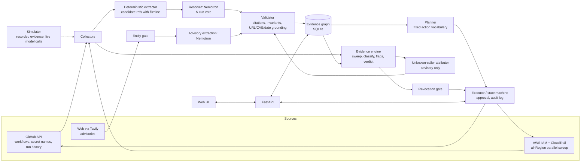

# SafeRotate — Scope, Architecture & Design Refinements (v2)

**Status:** v2 — Oct 12, 2026, after spike round 1. **v3 (design freeze) is written after the final validation round** (`04_final_validation_round.md`). After that round there are no more spikes: anything still unproven becomes a documented limitation with a fallback.
**Companion docs:** `01_spike_test_README.md` (round 1 brief), `03_competitive_research.md`, `04_final_validation_round.md`, spike `RESULTS.md` (source of every measured number below).
**Deadline:** Fri Oct 30, 2026, 10:00 a.m. Phoenix (MST). Plan to submit Thu Oct 29. **18 days left as of this writing.**
**Still unknown:** team size and skills. Scope below is tiered so it can be sliced.

---

## 0. TL;DR

1. **Verdict: GO WITH CHANGES.** The core value, a runtime-evidence gate for revocation, is confirmed. The AWS evidence sources behave in ways that force specific design decisions (§2).
2. **The model's job is smaller and more honest than v1 claimed.** Ultra beat regex on precision (0.67 vs 0.15) but not much on recall (0.54 vs 0.48), and runs disagree. Static discovery is therefore *hints plus voting plus human confirmation*, and the **runtime sweep is the safety net**. That is also a better story: "static discovery will always miss something, which is exactly why we watch the key."
3. **Tavily's date-window idea is downgraded.** It reliably finds known incidents but mislabelled `actions/checkout` and gave unstable end dates. New design: entity-matched advisory flag, **conservative union window, human confirms**, deterministic run-history correlation.
4. **Kubernetes is cut from the MVP.** It was never validated (`kind` not installed) and adds the most scope. The second consumer becomes a second GitHub workflow/environment plus the hidden cron host.
5. **Biggest unproven pieces** (these are what the final round tests): the GitHub update-and-verify loop, unknown-caller attribution by the model, and an improved discovery pipeline.
6. **New pitch asset:** we measured four blind spots in AWS's own evidence (§2). Showing them is credible, specific, and unusual for a hackathon demo.

---

## 1. What the spike settled

| Question | Verdict | Evidence (from RESULTS.md) | Design consequence |
|---|---|---|---|
| Does CloudTrail `LookupEvents` show a key's management calls? | **Confirmed** | 15/15 calls visible by AccessKeyId, ≤2.4 min (upper bound), with sourceIPAddress, userAgent, key ID | Evidence gate is viable and demoable. |
| Does one Region's lookup see everything? | **Refuted** | eu-west-1 and us-west-2 events only visible in their own Region | **Mandatory all-Region sweep.** 17 Regions: 12.0 s sequential, 1.9 s with 8 parallel workers, 0 throttles. |
| Are S3 object reads visible? | **Refuted (blind)** | 0/6 for ListObjectsV2 and GetObject | First-class `DATA_PLANE_BLIND` warning; demo consumers use management calls. The sandbox had no trail at all. |
| Does last-used reveal where a key is used? | **Refuted** | Floored to the minute; one service/Region only (reported `s3`/us-east-1 though calls also hit EC2 and other Regions) | Treat as a coarse "used recently" boolean only. |
| Are failed calls on a deactivated key visible? | **Refuted** | 0 events after 30 min, by key ID and by event name | **Break detection must not rely on CloudTrail.** Use consumer-side signals (CI results, pod/app health). |
| Is deactivation fast and reversible? | **Confirmed** | Effective in 7.6 s; reactivation in 10.1 s | Deactivate-first is genuinely a rollback. |
| Does a new key work immediately? | **Mostly** | New key authenticated after ~10 s | Poll `sts get-caller-identity` before distributing the key. |
| Two-key limit | **Confirmed** | `LimitExceeded: Cannot exceed quota for AccessKeysPerUser: 2` | Invariant "never create a third key" is grounded. Show the exact error. |
| Can Nemotron on Token Factory do the work? | **Yes, with caveats** | 4 Nemotron models reachable; reasoning on by default and eats `max_tokens` (4k cap truncated most runs); both base URLs work with different catalogs (25 vs 18 models); no Nano Omni | Pin endpoint and settings (§3). |
| Is model output consistent? | **No** | 0/3 identical groupings for every model; Ultra recall ranged 0.39–0.71 | Vote/merge, validator, human confirmation. |
| Prompt injection from repo files | **Held** | No model obeyed the injected file in the grouping or plan tasks | Keep as a demo/red-team feature. |
| Prompt injection from scraped web text | **Failed until fixed** | Ultra followed instructions embedded in pages when instructions came before ~21k chars of sources | Sources first, in delimiters, with `json_object` output. Never let retrieved text reach an action path. |

**Caveats on the evidence:** delay figures are upper bounds because polling cycles were ~95 s; the benchmark fixture (15 files, 4 credentials, 52 true pairs) was authored by the same system that ran it; test volume was tiny, so busy-key pagination is untested (§5).

---

## 2. Our measured "four blind spots" (pitch + product)

1. **Regional:** a lookup in one Region cannot see calls made in another.
2. **Data plane:** S3 object reads never appear in `LookupEvents`.
3. **Last-used is coarse:** minute resolution, one service, one Region.
4. **Rejected calls are silent:** failed authentication after deactivation does not appear.

SafeRotate handles each explicitly: an all-Region sweep, a data-plane warning with an opt-in "create a trail with data events" upgrade, last-used demoted to a boolean, and consumer-side break detection. This is the "honest about what it can't see" positioning, now backed by measurements.

---

## 3. Model role (revised from v1 §3)

### 3.1 Principle
The deterministic engine does what must be exact (evidence, verdict, invariants). The model does what is messy: reading heterogeneous files, proposing links, and explaining an unknown caller. **The model never gates and never acts.**

### 3.2 Discovery: hybrid, voted, confirmed
1. **Deterministic extractor** pulls candidate references with `file:line` (env var names, `secrets.X`, `secretKeyRef`, compose/Helm/Terraform variable names, key-ID literals).
2. **Model resolves** candidates into groups (only the ambiguous remainder), with citations.
3. **N-run vote:** an edge in ≥ k of N runs is accepted as `INFERRED`; lower agreement is shown as "possible" and never becomes an update target without a human click.
4. **Validator** drops anything whose cited file/line/symbol doesn't exist, and anything that merges credentials with different key IDs.
5. **Runtime sweep is the backstop:** a consumer discovery missed will still show up as an `UNKNOWN_CALLER`.
*Thresholds (k, N) and expected recall come from the final round; this is where v3 gets its numbers.*

### 3.3 Measured baseline (for the benchmark table)

| Method | Precision | Recall | Citation validity |
|---|---|---|---|
| Regex only | 0.43 | 0.06 | 1.00 |
| Regex + fuzzy (difflib ≥0.75) | 0.15 | 0.48 | 1.00 |
| Ultra 550B (mean of 3) | 0.67 | 0.54 | 0.95 |
| Super 120B | 0.37–0.72 | 0.29–0.35 | 0.88–0.94 |
| Nano 30B | 0.10–0.75 | 0.02–0.31 | 0.87–1.00 |

### 3.4 Model configuration (current best, pending final-round confirmation)
- **Endpoint:** `https://api.tokenfactory.nebius.com/v1/` (25 models; the us-central1 endpoint lists 18).
- **Ultra** `nvidia/Nemotron-3-Ultra-550b-a55b` for resolution and attribution; **Super** `nvidia/nemotron-3-super-120b-a12b` for bulk extraction. Avoid Lightning with reasoning enabled (it exhausted its token budget every run).
- **Reasoning:** `extra_body={"chat_template_kwargs":{"enable_thinking": false}}` turns it off on all four models; system-prompt switches do not. If left on, budget `max_tokens ≥ 16384`.
- **Structured output:** `json_object` for Ultra (19/20); `json_schema` for Super and Nano (20/20).
- **Prompt layout:** retrieved or repo content first, in delimited blocks; instructions last.
- **Cost:** no pricing in the API. Read the public price page and compute cost per scan (final round).

### 3.5 Unknown-caller attribution (kept, still unvalidated)
Input: deterministic facts about a non-matching caller (IP, user agent, event names, Regions, call cadence from timestamps) plus repo/crontab clues. Output: ranked hypotheses with citations, a confidence, and a "how to confirm" step. It is advisory and never clears a block. Entro publicly describes baselining and narrated incidents, so the pattern is validated in the market; ours is open source and every claim is machine-checked. **The final round must show it can pick the right script and, just as important, say "unknown" when no clue fits.**

### 3.6 Optional Nebius depth (P2, unchanged)
Running the evaluation harness as a Serverless Job or the API as a Serverless Endpoint strengthens "effective use of Nebius" but is not required and the advertised credits cover Token Factory only.

---

## 4. Tavily (revised from v1 §4)

**Test for load-bearing:** if Tavily were removed, would a decision change? Target: yes.

### 4.1 Design
1. List third-party Actions used by workflows that receive the credential (public names only).
2. For each, Tavily search (basic first, advanced only if needed) and extract on advisory sources.
3. **Entity gate (deterministic):** keep only results whose text contains the exact `owner/repo` string. This removes the `actions/checkout` → git-CVE false positive.
4. **Model extraction** with sources first, `json_object`, thinking off; validator requires evidence URLs ∈ result set and CVE IDs/dates present literally in the text.
5. **Conservative window:** take the union (min to max) of dates found in incident-specific passages, show it as "claimed", and let the user confirm or edit. Over-flagging is the safe direction, so unstable end dates become wider windows, not wrong ones.
6. **Deterministic correlation:** list workflow runs inside the window, map each to the secrets its jobs received (from the workflow YAML), and recommend leak-mode review for exactly those credentials, ranked first.

### 4.2 Measured
- 4 of 5 actions classified correctly, 100% grounded, fabricated action → `no_findings`.
- Known incidents found with authoritative sources: `tj-actions/changed-files` (CVE-2025-30066) and `reviewdog/action-setup` (CVE-2025-30154).
- Start dates right; the `tj-actions` end date differed between runs (2025-03-14 vs 2025-03-17).
- **27 credits per 5-action scan** (free tier: 1,000/month). Cache per action per day.

### 4.3 Fallback
If the final round shows the union window is still unreliable, ship "advisory exists + cited link + affected workflows" and make the window a manual input. Tavily stays load-bearing because the advisory still changes which workflows and secrets are flagged.

### 4.4 Stacking reminder
Rules: one Overall Award, **or** one Track Award plus one Bonus Award. Track win + Tavily ($3,000) is the best *stack*; an Overall placement replaces both. Build the best product and keep Tavily in either way.

---

## 5. Evidence engine specification (new, from measurements)

| Element | Spec |
|---|---|
| Sweep | `LookupEvents` by AccessKeyId in all enabled Regions, ~8 parallel workers, exponential backoff. Query only since cutover time. |
| Volume risk | Tested on tiny volume. Real keys can have thousands of events/day (50 per page, ~2 requests/s/Region). Mitigate with time-window queries, signature dedupe `(ip, userAgent, eventSource, eventName, region)`, a page cap, and a visible `TRUNCATED` coverage warning. |
| Freshness | Events visible within ~2.4 min (upper bound; final round tightens). Show "evidence as of T" and do not evaluate the gate on the last few minutes. |
| Last-used | Boolean "used recently" only. |
| New key | Poll `sts get-caller-identity` (typically ~10 s) before distributing. |
| Deactivate | Effective in ~8 s; verify by consumer-side signals; rollback = reactivate (~10 s). |
| Coverage flags | `DATA_PLANE_BLIND`, `CADENCE_UNKNOWN`, `TRUNCATED`, `REGION_SWEEP_PARTIAL`. |
| Verdict | `BLOCKED` / `CAUTION` / `READY` with reasons, as in the README. |

---

## 6. Revised scope

### P0 — the demo cannot exist without these
1. Evidence engine (§5) and caller classifier, with the verdict and reasons.
2. GitHub Actions consumer: discover secret names and `secrets.*` references, update the secret (sealed box), dispatch the verify workflow, confirm the new key ID in CloudTrail. *Add per-run attribution if the final round confirms a user-agent tag (`AWS_SDK_UA_APP_ID`).*
3. One hidden consumer (cron on a laptop or small VM) for the unknown-caller twist.
4. Hybrid discovery + vote + validator (§3.2) and unknown-caller attribution (§3.5).
5. Tavily flag with entity gate and conservative window (§4).
6. Web UI: dependency graph with evidence classes, "if revoked now" simulation, plan and approval, run timeline, verdict with reasons.
7. Simulator mode with recorded evidence and **live Nemotron/Tavily calls**, plus a "paste your own files" box. Clearly labelled as a simulation.
8. Safety basics: dry-run default, approval gate, audit log, aliasing, entropy filter, no secrets in prompts/logs.
9. Honest benchmark table including failures.

### P1 — if P0 is green by ~Oct 22
- **Cloudflare check:** require the new key ID to be observed from the *intended* consumer, not just any consumer. Enabled by per-workflow tagging.
- Leak mode lite (contain, rotate, review; consumes the Tavily output).
- Self-consistency calibration chart; injection red-team page (repo files and web text).
- Portfolio polish: Dockerfile and compose, CI, threat model, structured logs, screenshots, sample IAM policy.

### P2 — stretch
Kubernetes discovery (read-only), Serverless Job/Endpoint on Nebius, blast-radius panel, rotate-or-eliminate (OIDC) suggestions, opt-in trail with data events.

### Cut
**Kubernetes in the MVP** (unvalidated, highest scope), CLI, separate T4/T5 model tasks, Terraform/GitOps/other clouds, org-wide GitHub, vault integrations, city awards (in-person only, none in Phoenix).

---

## 7. Revised architecture

**Invariants (validator-enforced):** (1) never deactivate in hygiene mode before every known consumer is verified; (2) never delete before deactivate plus the wait; (3) never create a third key; (4) no mutating step without approval (except dry-run); (5) reactivating a compromised key needs explicit confirmation and a TTL; (6) verification must observe the new key from the **intended** consumer; (7) any model-proposed edge or hypothesis stays `INFERRED` until a human confirms it; (8) retrieved web text and repo text are data, never instructions.

---

## 8. Demo narrative (under 3:00)

| Time | Beat |
|---|---|
| 0:00–0:15 | Hook: Cloudflare's rotation outage (March 2025) or "64% of leaked 2022 secrets still valid in 2026" (GitGuardian). One sentence. |
| 0:15–0:45 | Scan → graph. Differently named references get linked; each edge shows its evidence class and citation. |
| 0:45–1:05 | Tavily: a workflow uses a compromised action; the advisory, the window, and *which runs and secrets* were exposed → review those first. |
| 1:05–1:20 | "If revoked now": the deploy breaks. |
| 1:20–2:00 | Rotate: new key → update GitHub secret → verify run → new key ID appears in CloudTrail (waits edited out; disclose in the description). |
| 2:00–2:40 | The twist: old key still used by an unknown caller; verdict BLOCKED; Nemotron proposes "likely `scripts/backup.sh` cron" with cited evidence; resolve → READY → deactivate. |
| 2:40–3:00 | "Four blind spots we measured in AWS's evidence" + honest benchmark table. |

---

## 9. Feedback to submit (collected during the spike)

Required for submission and eligible for Most Valuable Feedback (judged on completeness, viability, impact).
- Reasoning is on by default and counts against `max_tokens`; truncation is silent. System-prompt toggles don't work; `enable_thinking` via `chat_template_kwargs` does.
- The two Token Factory base URLs serve different model catalogs (25 vs 18); docs don't say which to use.
- Brief/docs mention models (Nano Omni) not present; an unlisted `Nemotron-3_5-Lightning` is.
- No pricing in the models API, so cost per scan can't be computed programmatically.
- Structured output reliability varies by model and method (Lightning only worked with tools; Ultra best with `json_object`).
- Rate limits are shown as request/token pairs (e.g. 300 / 200k on Super and Ultra) without stating the time window; please document it.
- Positive: trivial calls returned in under a second on three of four Nemotron models, and the OpenAI-compatible API worked unchanged.

---

## 10. Freeze gate and decision rules for the final round

Run the final round (`04_final_validation_round.md`), then freeze. Decisions:

| Final-round result | Decision |
|---|---|
| GitHub loop works end to end, tag appears in CloudTrail | P0 as written; Cloudflare check becomes P1-likely. |
| GitHub loop works but no usable tag | Verify by new key ID in CloudTrail + run-time correlation only; Cloudflare check dropped. |
| GitHub loop fails | Fallback: user confirms the secret update; gate relies on new-key-ID evidence. Flag as a major risk. |
| Attribution top-1 correct in most runs **and** abstains on the no-clue case | Ship as advisory feature. |
| Attribution picks a script when none fits | Downgrade to an unranked "candidate clues" list. |
| Hybrid discovery reaches the target on the multi-fixture set | Ship with the voting thresholds found. |
| Hybrid discovery stays low-recall | Keep it as "hints"; emphasize runtime evidence in UI and pitch. |
| Entity gate removes false positives; union window covers primary-source dates | Ship conservative window. |
| Window still unreliable | Advisory flag + manual window (§4.3). |

---

## 11. Timeline

| Dates | Milestone |
|---|---|
| Oct 12 (tonight) | Provide `GITHUB_REPO`; start the final round. |
| Oct 13 | Final round completes. I write **v3 (freeze)**. |
| Oct 14–18 | Scaffold, CI, data model; collectors; evidence engine; GitHub loop. |
| Oct 19–22 | Discovery pipeline, validator, benchmark; Tavily path. **Checkpoint Oct 22:** scan → rotate → verify → block-on-unknown-caller running end to end, or cut P1 entirely. |
| Oct 23–26 | UI, simulator, attribution, leak mode lite, Cloudflare check if ahead. |
| Oct 27–28 | Hosted demo, tests, README results, feedback write-up. |
| **Oct 29** | Record video (< 3:00), upload to YouTube, final README, **submit**. Oct 30 morning is buffer only. |

Hosting must stay up through the judging period ending Dec 15, 2026 (noon Pacific).

---

## 12. Corrections still to apply to the project README

| Claim | Fix |
|---|---|
| "exposed CI secrets across more than 23,000 repositories (per CISA)" | Say "used by 23,000+ repos"; later analyses counted far fewer actual leaks (218 in one). |
| CloudTrail limits | Add: per-Region, 50 results/page, ~2 requests/s/Region, no S3 data events, failed auth not visible. |
| Wedge statement | "Open-source, local-first, evidence-cited, honest about blind spots", not "nobody does this" (Oasis and GitGuardian market consumer mapping). |
| Scope | Remove Kubernetes and CLI from the MVP list. |
| "Miasma" npm note and CSA PDF | Verify or remove (unverified). |
| Tavily section | Replace with §4. |
| Benchmark table | Replace TBD with measured numbers. |

---

## 13. Open questions

1. Team size and skills (asked repeatedly; decides how much P1 is realistic).
2. Where the hosted simulator runs through Dec 15, and who pays.
3. Per-scan model cost (needs the public price page).
4. Overall placement versus Track + Tavily (decide after the first full demo run).
5. Opt-in trail with data events: worth the demo time?

---

## Changelog
- **v1 (Oct 11):** refinements before spike results.
- **v2 (Oct 12):** integrated spike round 1; Kubernetes cut; Tavily downgraded to entity-gated advisory with conservative window; hybrid discovery; evidence engine spec; freeze gate.
- **v3 (pending):** freeze after the final validation round.
